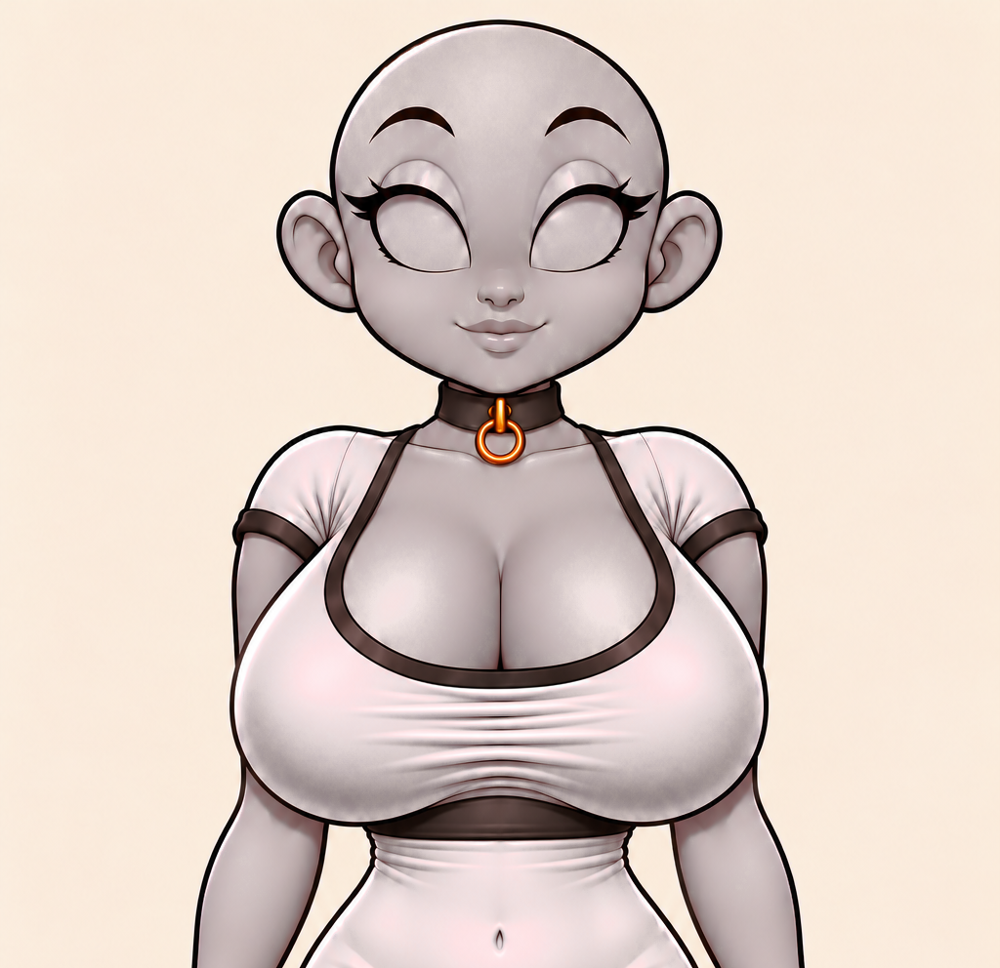
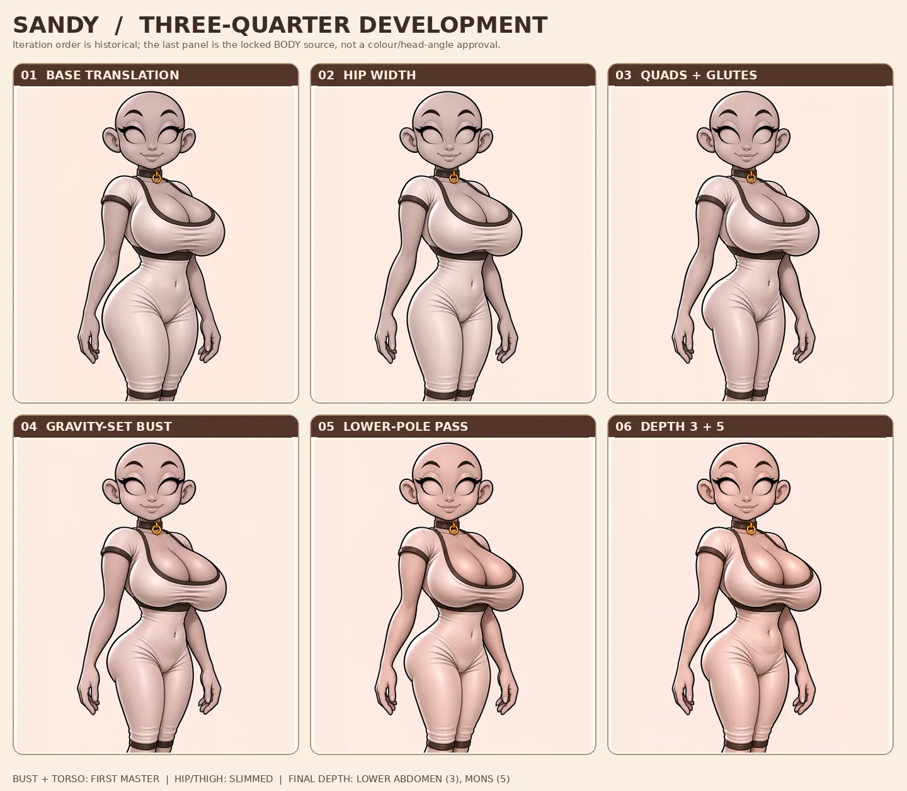

# Growlfriends — Shared Anatomy Guide
**Model:** Sandy, the neutral clay mannequin · **Status:** illustrated visual standard · **View:** upright, front-facing bust-up

Sandy is a **bald, feature-light, muted stone-grey clay mannequin** with softly sculpted eye wells (no irises/pupils), minimal nose and mouth, subtle brows, a pale grey scoop-neck shirt, charcoal trim, a **long, thick charcoal underbust/ribcage band**, and a charcoal choker with a gold O-ring. She is a teaching stand-in for the Growlfriends' **shared body geometry**, not a new species or a replacement for anyone's facial identity.

## Sandy anatomy comparison plates

Both after panels have been colour-matched to Sandy's canonical muted stone-grey clay skin, pale-grey clothing, charcoal trim and warm-gold hardware; the approved shape and crop were preserved. The before studies are historical **1920 × 1860 PNG** portraits. Both after panels now show the latest approved Sandy master from **21 November 2026** (generation ID `71c095c3-0c06-4469-a2c1-69005e70d2cb`), cropped from its native 1024 × 1536 render to a 1024 × 992 comparison image. Click for the source PNG; the website serves optimized AVIF copies. The different render iterations are **not pixel-registered**.

### Bust distribution — before and after

| Before: rounded upper fullness | After: current approved gravity-set master |
| --- | --- |
|  |  |

### Head scale — before and after

| Before: standard head | After: current master with enlarged cartoon head |
| --- | --- |
|  |  |

These images illustrate stylistic progression, not precise 3D measurements. **Caution:** The updated head-after panel also contains later approved bust refinements; it is not a controlled head-only A/B comparison. Existing neck, shoulders, ribcage, waist, pelvis and leg locks remain in force, and these new reference crops do not unlock them.

## Bust anatomy — six essentials

1. **Weight through the middle and bottom.** Concentrate the visual fullness in the mid and lower poles; avoid a high, perkily rounded upper-pole mound.
2. **Oblong rather than spherical.** Favor generous horizontal breadth and softly lengthened lower arcs, rather than two symmetrical spheres.
3. **Lower-outer breadth, not armpit swelling.** The mass widens toward the lower sides; the upper-lateral/axillary contours remain locked.
4. **A smooth lower sweep.** Keep only a modest central rise in the clothed underbust. Avoid a sharp W-shaped indentation or separated round fabric pouches.
5. **A narrow stable ribcage.** Do not widen shoulders, ribcage, or waist to account for the broad bust; the approved petite underlying frame stays identical.
6. **Cloth follows volume.** Use gentle transverse stretch over the breast mass and fewer folds except underneath the weight; avoid compressed, vacuum-sealed cleavage and artificial lift.

The existing total bust scale, upper-chest attachment, cleavage position, upper-pectoral region, and armpit area are **hard-locked unless individually unlocked**. The illustrated improvement is chiefly a **redistribution of form and fabric tension**, not simple enlargement or lowering of the whole bust.

## Head scale — before and after

The **bottom pair** illustrates the approved proportional language: a noticeably **oversized cartoon head** on a **petite, mature adult body** with unchanged, normal, narrow neck and shoulders.

- Enlarge the **whole head as a unit** — skull, face, cheeks, ears, hair (if present) — without redesigning or separately exaggerating any face feature.
- Keep facial geometry, eye shape and spacing, nose, mouth, expression, species-specific anatomy and head silhouette consistent with each girl's established identity.
- **Hard-lock everything from the neck down:** neck thickness and length, shoulders, arms, bust, torso, narrow ribcage, thick charcoal underbust band, collar, costume and all lower geometry.
- Connect the larger head cleanly at the original neck junction. Do not change the neck, widen the shoulders, shrink the torso, raise the body, or zoom out.
- Preserve the front-on upright pose and the lower frame; make extra room for the larger head above rather than rescaling the body.
- Use the **illustrated visual ratio**, not an invented measured factor. The earlier tentative 8–12% estimate was exploratory, not a final measurement.

## Anterior depth — v0.1 (alpha)

**Status:** front-view appearance approved on 21 November 2026; Z-axis geometry remains provisional pending a side-profile or three-quarter study. **Checkpoint:** Sandy head-to-knee render `09e8e0c2-3ad2-4f1b-9c80-50b80d36acd2`.

| Region map (earlier labeling reference) | Approved head-to-knee checkpoint |
| --- | --- |
|  |  |

The map identifies the regions only; its pictured anatomy predates the final refinements. The later portrait is the approved visual target. These are compressed reference previews, not measured 3D geometry.

**Core principle:** selective softness on a relatively slender underlying frame. Preserve the approved X-axis widths, Y-axis heights and placement, and alter only the intended anterior surface depth.

| Region | Fullness | Target geometry |
| --- | --- | --- |
| 01 Upper abdomen | Lean | Smooth, restrained contour immediately below the ribcage. |
| 02 Umbilical region | Lean | Gentle contour around the navel; maintain its position. |
| 03 Lower abdomen | Plump | Soft convex lower-belly contour, distinct from the lean upper abdomen. |
| 04 Anterior hips | Lean | Restrained forward prominence; do not change hip width. |
| 05 Mons pubis | Full | Natural rounded pelvic contour under opaque clothing, blended into adjacent forms. |
| 06 Inguinal folds | Recessed | Natural pelvis-to-thigh transitions without excess protrusion. |

### Locks and clothing

- Preserve the approved upper master, ribs, waist, abdomen length, hip width, pelvic placement, thigh diameter, stance, and slight upper-thigh separation.
- The thick charcoal rib band remains intact. Opaque white high-waisted fitted bottoms begin directly beneath it and continue to the knee cuffs.
- Use gradual, connected surface transitions rather than isolated bulges; clothing follows the form with restrained, natural tension.
- Keep the narrower thighs from the final approved checkpoint. Do not silently restore the wider thighs in earlier references.
- “+1 puff” is qualitative art-direction shorthand, not a percentage, distance, or measured volume.
- Do not infer actual sagittal depth from frontal shading. A later side study will be needed to promote this alpha into a locked three-dimensional standard.

## Three-quarter anatomy transfer — v0.1 (alpha)

The three-quarter study preserves the now-approved **rightward body orientation, heavy oblong bust projection, narrow waist, lifted rounded glutes, slimmer quadriceps, and soft anterior depth at regions 03 and 05**. The **body shape is locked**. In the supplied geometry checkpoint, the **head remains too frontal and the skin/clothing palette is not canonical**; those are the only two pending corrections.

[Open the fully illustrated, iterative three-quarter guide](sandy-three-quarter-guide.md).

## Side-profile chest — v1.0 (approved)

The right-facing 90° chest reference is locked at checkpoint `e4e0d854-c431-40b1-8b56-349c9bc32116`. The correction removes residual three-quarter perspective: the near contour occludes the far contour without reducing the intended volume. The approved forward projection, lower curve, neckline and fabric response are retained. **Glutes and other side-profile anatomy remain provisional.** See the [dedicated side-profile guide](sandy-side-bust-guide.md) and its [actual approved chest crop](../assets/anatomy/sandy-side-bust-approved.webp).

## Side-profile posterior — v1.0 (approved)

The posterior contour and upper-thigh transition are now independently approved at checkpoint `73361fbb-7bec-4deb-a048-c44ce75813e3`. Preserve the lower-set rounded silhouette and the narrower posterior upper thigh. See the [internal side-profile posterior guide](sandy-side-posterior-guide.md) for the actual iterative checkpoints and final-pass checks. This supersedes the earlier provisional posterior status; it does not lock unrelated unfinished side-view regions.

## Rear three-quarter posterior — v1.0 (hard-locked)

The rear-oblique geometry and surface rendering are now approved at generation `dd6a8f74-f95b-4774-bf94-bc159e8dd94d`. Preserve the lower-biased volume distribution, smooth continuous contour, slim thighs and small upper-thigh opening. The successful final pass removed obsolete nested shadow contours without an intentional geometry change. See the [detailed rear three-quarter posterior guide](sandy-rear-three-quarter-posterior-guide.md) for the full lock, iteration history, rendering reset method, and straight-rear transfer plan. The exact final reference retains temporary pink/lavender coloration; the separate canonical palette below supersedes its colors, not its shape.

### Canonical Sandy material palette (locked 21 November 2026)

- Exposed neutral grey clay: `#606060`.
- Opaque white shirt and bottoms extending to the knee cuffs: `#FFFFFF`.
- Black/near-black bands, cuffs and collar: `#111111`.
- Existing warm-gold O-ring; no new exact hex specified.

These are base swatches; lighting may vary. This palette supersedes earlier descriptions of pale-grey clothing or unspecified clay swatches. No swatch card in production renders. Shape approval is independent of color approval.

## Character transfer rule

**Sandy is neutral.** Her stone-grey skin and pale-grey/charcoal clothing are only a teaching palette; all Growlfriends inherit the same shared body mold and general enlarged-head proportional language, while preserving each character's separate skull, muzzle, ears/horns, hair, eyes, color scheme, material properties, and outfit aesthetic. A different garment can reveal the same underlying anatomy differently.

## Quick quality check

- [ ] Broad, heavy mid/lower bust; quiet upper pole
- [ ] Lower-outer volume is full but the armpit contour is unchanged
- [ ] Soft, continuous lower sweep and natural clothing tension
- [ ] Thick, long charcoal band wraps the narrow ribcage without compressing or widening it
- [ ] Ribcage stays narrow and the body scale stays fixed
- [ ] Head is visibly larger relative to the **unchanged** neck/shoulders
- [ ] Facial identity and features retain their internal proportions
- [ ] No body scaling, crop changes or hidden alterations to the shared mold

**Studio note:** These guidelines are **stylized illustration rules**, not medical/anatomical data or exact 3D measurements. See the [website's Shared Anatomy section](../index.html#anatomy) for the labelled visual study.
