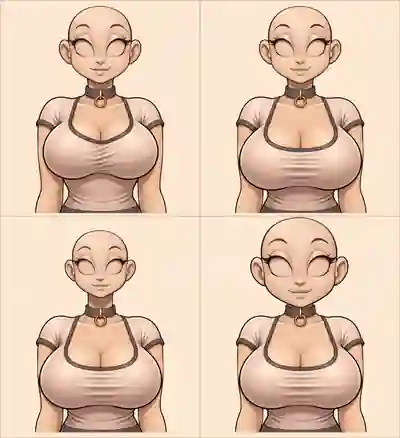

# Growlfriends — Shared Anatomy Guide
**Model:** Sandy, the neutral clay mannequin · **Status:** illustrated visual standard · **View:** upright, front-facing bust-up

Sandy is a **bald, feature-light, warm-ivory clay mannequin** with softly sculpted eye wells (no irises/pupils), minimal nose and mouth, subtle brows, and a neutral outfit. She is a teaching stand-in for the Growlfriends' **shared body geometry**, not a new species or a replacement for anyone's facial identity.

## Sandy anatomy comparison plate

The **top-left** panel shows the older, rounder bust silhouette. **Top-right** shows broader mid/lower fullness and a gentler lower fabric sweep. **Bottom-left** shows the smaller original head ratio; **bottom-right** enlarges the complete head on the unchanged petite body.

*These are schematic illustrations, not precisely registered 3D renders or percent-accurate measurements.*

## Bust anatomy — six essentials

1. **Weight through the middle and bottom.** Concentrate the visual fullness in the mid and lower poles; avoid a high, perkily rounded upper-pole mound.
2. **Oblong rather than spherical.** Favor generous horizontal breadth and softly lengthened lower arcs, rather than two symmetrical spheres.
3. **Lower-outer breadth, not armpit swelling.** The mass widens toward the lower sides; the upper-lateral/axillary contours remain locked.
4. **A smooth lower sweep.** Keep only a modest central rise in the clothed underbust. Avoid a sharp W-shaped indentation or separated round fabric pouches.
5. **A narrow stable ribcage.** Do not widen shoulders, ribcage, or waist to account for the broad bust; the approved petite underlying frame stays identical.
6. **Cloth follows volume.** Use gentle transverse stretch over the breast mass and fewer folds except underneath the weight; avoid compressed, vacuum-sealed cleavage and artificial lift.

The existing total bust scale, upper-chest attachment, cleavage position, upper-pectoral region, and armpit area are **hard-locked unless individually unlocked**. The illustrated improvement is chiefly a **redistribution of form and fabric tension**, not simple enlargement or lowering of the whole bust.

## Head scale — before and after

The **bottom pair** illustrates the approved proportional language: a noticeably **oversized cartoon head** on a **petite, mature adult body** with unchanged, normal, narrow neck and shoulders.

- Enlarge the **whole head as a unit** — skull, face, cheeks, ears, hair (if present) — without redesigning or separately exaggerating any face feature.
- Keep facial geometry, eye shape and spacing, nose, mouth, expression, species-specific anatomy and head silhouette consistent with each girl's established identity.
- **Hard-lock everything from the neck down:** neck thickness and length, shoulders, arms, bust, torso, ribcage, collar, costume and all lower geometry.
- Connect the larger head cleanly at the original neck junction. Do not change the neck, widen the shoulders, shrink the torso, raise the body, or zoom out.
- Preserve the front-on upright pose and the lower frame; make extra room for the larger head above rather than rescaling the body.
- Use the **illustrated visual ratio**, not an invented measured factor. The earlier tentative 8–12% estimate was exploratory, not a final measurement.

## Character transfer rule

**Sandy is neutral.** All Growlfriends inherit the same shared body mold and general enlarged-head proportional language, while preserving each character's separate skull, muzzle, ears/horns, hair, eyes, color scheme, material properties, and outfit aesthetic. A different garment can reveal the same underlying anatomy differently.

## Quick quality check

- [ ] Broad, heavy mid/lower bust; quiet upper pole
- [ ] Lower-outer volume is full but the armpit contour is unchanged
- [ ] Soft, continuous lower sweep and natural clothing tension
- [ ] Ribcage stays narrow and the body scale stays fixed
- [ ] Head is visibly larger relative to the **unchanged** neck/shoulders
- [ ] Facial identity and features retain their internal proportions
- [ ] No body scaling, crop changes or hidden alterations to the shared mold

**Studio note:** These guidelines are **stylized illustration rules**, not medical/anatomical data or exact 3D measurements. See the [website's Shared Anatomy section](../index.html#anatomy) for the labelled visual study.
