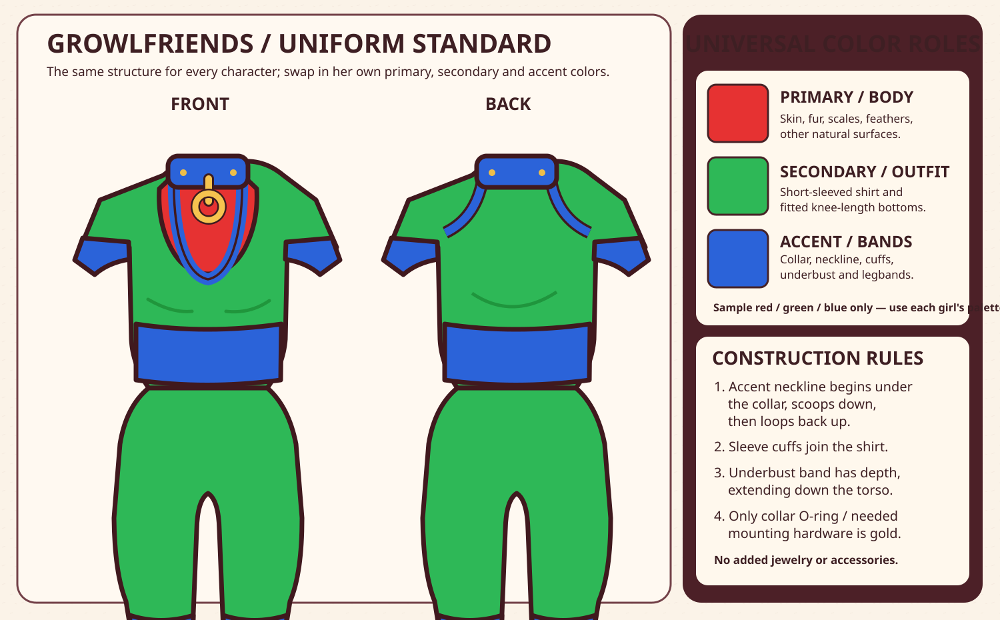

# Growlfriends — Universal Uniform Construction and Color Roles

**Status:** Working visual uniform standard, established 23 November 2026. **Applies to all Growlfriends unless the user explicitly specifies a character exception.** Use alongside the [expressive rendering guide](growlfriends-expressive-cartoon-rendering-guide.md) and the character's own reference and approved anatomy.

## The most important rule: color is assigned by **what a surface is**, not by its location

| Role | Universal assignment | Red/green/blue demonstration |
| --- | --- | --- |
| **Primary** | Natural **skin, fur, scales, feathers, or other bodily material**, including visible chest, arms and legs | RED |
| **Secondary** | **Clothing fabric:** fitted short-sleeved shirt and opaque fitted knee-length bottoms | GREEN |
| **Accent** | The **pet collar, neckline piping, sleeve cuffs (formerly called armbands), deep underbust/waist band, and legbands** | BLUE |
| **Hardware** | **Only** the collar's hanging metal O-ring and minimal necessary attachment pieces | GOLD |

**Do not treat these red, green, and blue demo colors as Bubble's colors or as any girl's actual final palette.** Each girl inherits the **color roles** using her own documented primary/secondary/accent swatches. Fur/scale markings and intentional individual variations are permitted only as approved exceptions.

## Uniform shape and assembly

1. **Collar:** A snug accent-colored **pet collar** around the neck with **one hanging gold O-ring**. The ring hangs visibly below the collar; it is **not a central clasp** and not a generic necklace. No invented earrings, bracelets, piercings, hairpins or extra gold jewelry.
2. **Neckline construction:** Accent-colored piping originates **under the collar on both sides**, descends toward the chest, forms **one continuous rounded scoop** showing **noticeable but not excessive natural cleavage**, then curves upward again. The neckline piping is the **accent** color, *not* secondary fabric color. Do not make a cutaway bra, disconnected straps, sharp V, or a second decorative harness.
3. **Shirt:** One **opaque secondary-colored garment** covering both shoulders, with short sleeves and a continuous bust/front section. The chest is **natural primary color only within the neckline's opening**; elsewhere the colored area is fabric. Fit reflects approved Sandy/Mallow bust weight and material rendering. No invented crop top/bikini.
4. **Sleeve cuffs:** Accent-colored bands are **integrated into the ends of the shirt sleeves**, not loose floating armbands on exposed skin. Only a single accent cuff per sleeve; never double-stack two colors.
5. **Underbust band:** A single substantial accent-colored band immediately below the weighted bust. It extends downward along the ribcage, wider than the initial narrow strip, approximately **10–15% deeper than the prior approved working diagram**. Its width tapers naturally with the torso; do not separate it from the shirt, and do not move the bust to achieve the band change.
6. **Bottoms:** **Opaque secondary-colored, close-fitting knee-length** bottoms continuing uninterrupted to integrated accent-colored **legbands at the knees**. They are not panties, shorts, bare legs, stockings, or separate tights unless specifically requested.
7. **Back:** Same sleeve cuff integration, collar, underbust band depth, fitted bottoms and legbands. There is **no cleavage** on the back. Preserve structural continuity from front to rear.

## What must remain stable on future adaptations

- Shared **Sandy anatomical geometry** (where applicable), not a new shape for each girl.
- Distinct head/species identity and individual palette: read each girl's approved reference first.
- Outfit **construction and color roles** above. Hair and fur pattern variations must not silently recolor fabric.
- Clean, expressive burgundy linework and deliberate broad cel-shade shapes.
- No added character, jewelry, or props in stand-alone outfit studies.
- For image-based guides, no character-name label or character-specific palette unless deliberately requested.

## Common mistakes to reject

- Labeling primary color as the shirt rather than **the body**.
- Labeling secondary color as the collar/neckline rather than **clothing**.
- Labeling accent color as arbitrary highlights rather than the **bands and trim**.
- Confusing exposed cleavage skin with neckline fabric.
- Leaving green/red intermediate rows above an accent-colored cuff: **the cuff is a single accent-colored unit attached directly to the sleeve**.
- Making a narrow belt at the waist instead of a **deep underbust band**.
- Drawing a camisole/crop-top with briefs instead of **short sleeves plus knee-length bottoms**.
- Inventing additional jewelry, studs, charms, floral accessories or hair decorations.
- Copying the Mallow sample's skin/fur or Connie's feathers to another species.

## Production prompt fragment

> Use the approved Growlfriends universal outfit construction. **Primary = natural body, secondary = shirt and opaque knee-length bottoms, accent = pet collar, continuous scoop-neckline piping from beneath the collar, integrated short-sleeve cuffs, substantial underbust band and knee legbands; gold = hanging collar O-ring only.** Keep one continuous clothing system and preserve the girl's approved anatomy, species, identity, palette and current framing. Do not borrow another character's colors, invent accessories, create a crop top, detach sleeve cuffs, or expose the legs above the knee cuffs. Follow the approved expressive-cartoon rendering guide.

## Visual reference provenance

The SVG above is a **directly viewable, editable schematic** committed with this document; it communicates construction and color semantics, not pixel-perfect proportions or anatomical measurements. The companion user-approved illustrated graphic was generated as image `1e7a7464-3ffc-46e4-be6e-1f8700b0363b` during the 23 November workshop and may be uploaded later under `assets/style/growlfriends-uniform-guide-final.png`. That PNG is **not yet in the repository** if the file path is absent; do not falsely claim it is.

**Authority:** user-approved character designs > this uniform construction and color role convention > miscellaneous generation prompts.
