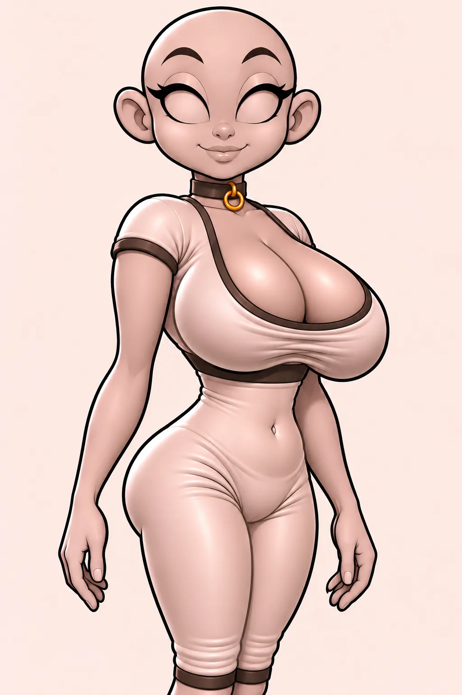
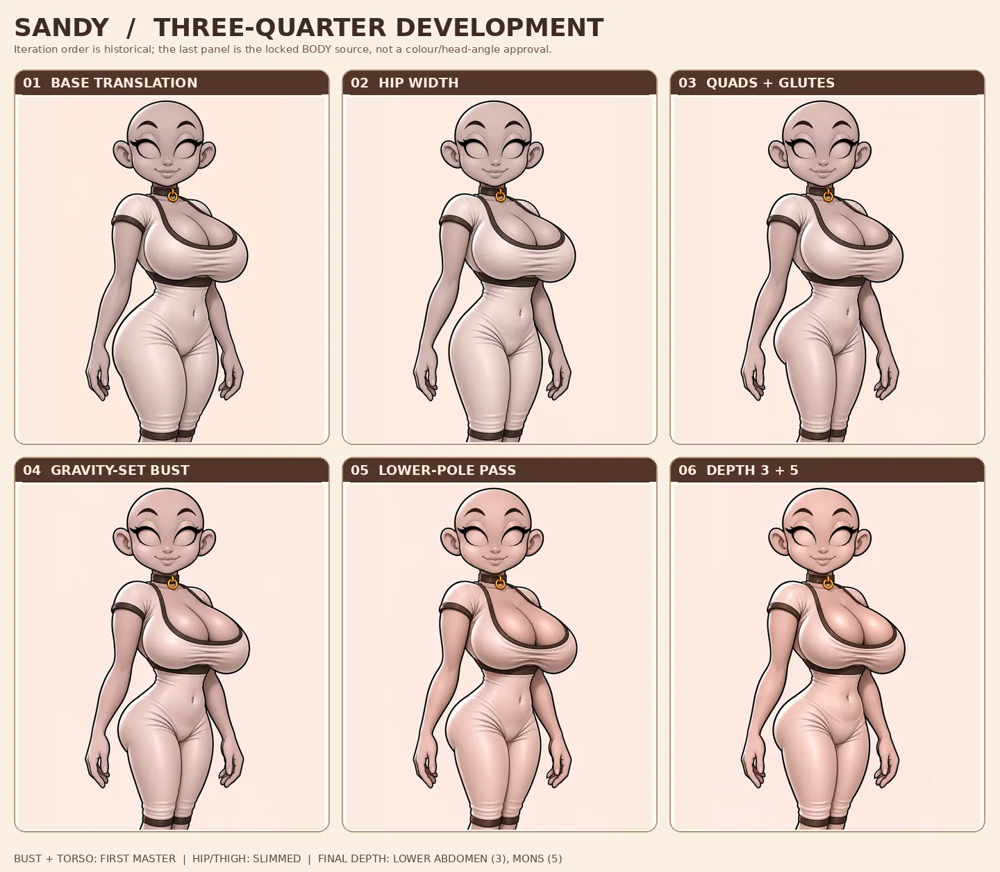

# Sandy — Three-Quarter Front Anatomy Transfer
**Growlfriends studio guide · Alpha v0.1 · 21 November 2026**

**Status:** the **body geometry** of the latest three-quarter reference is approved and locked. **Head orientation and colour are not yet approved in that particular source image.** Do not confuse the uncorrected source with the intended finished portrait.

[Return to the shared anatomy guide](growlfriends-bust-anatomy.md) · [Website anatomy atlas](../index.html#sandy-threequarter)

## 1. Reference hierarchy

| Reference | What it controls | What it must **not** control |
| --- | --- | --- |
| [Current three-quarter body-shape checkpoint](../assets/anatomy/sandy-3q-shape-checkpoint.webp) | Camera/body orientation; head-to-knee crop; 3D bust distribution; underbust band; waist/hip/thigh geometry; lifted rounded glutes; lower-abdomen and pelvic depth; arm placement | **Not** final clay-grey skin, white-and-black palette, or head yaw |
| [Six-stage development gallery](../assets/anatomy/sandy-3q-iteration-gallery.webp) | Chronological explanation of how the 3/4 model was refined | None of its earlier stages supersedes the last body-shape checkpoint |
| [Shared frontal anatomy guide](growlfriends-bust-anatomy.md) | Enlarged cartoon head scale; facial identity; bust morphology and size principles; narrow underbust; X/Y body locks; Sandy's canonical colour/materials | Do not flatten the three-quarter perspective into a frontal shape |

### Locked three-quarter body-shape checkpoint

**Reading this image:** take the pictured anatomy, pose, crop and proportions as the master. **Only two corrections remain:** turn the head into a genuine three-quarter view **facing right**, and correct the palette to grey clay skin, white outfit and black accents. The source's peach/pink clay colour is not canonical.

## 2. The iterative build

These are qualitative, successive art-direction revisions, not measured percentage changes. Treat each stage as modifying only its named variable; retain the prior approved decisions.

1. **Base 3/4 transfer** — establish an upright, rightward body orientation and roughly three-quarter view, relaxed arms and studio framing. The first head was still too front-facing.
2. **Narrow hip width** — reduce pelvic and upper-hip breadth; preserve the already approved narrow ribs and waist.
3. **Slim quadriceps; retain perky, round glutes** — concentrate posterior mass in raised, rounded glute projection instead of broad thighs. Maintain the near-side/far-side leg relationship.
4. **Gravity-set bust translation** — take the frontal bust guide into depth: softer upper slope, greater mid/lower fullness, more oblong volume, weighted lower contour, natural stretch over opaque white fabric. Keep overall bust scale and its chest attachment consistent.
5. **Final lower-pole refinement** — modestly refine the underside and fabric sweep without making the breasts simply bigger, higher, or spherical.
6. **Depth regions 3 and 5** — retain a comparatively lean upper abdomen and navel area, with gentle forward fullness at **03 lower abdomen** and **05 mons pubis**, both originally directed as **+1 puff**; unchanged hip width and thigh separation. This sixth image is the **locked body-shape master**.

## 3. Shape locks in the three-quarter view

- **Preserve the underbust band downward:** black/charcoal long band, narrow ribcage, waist, pelvis, hip width, glute height and rear projection, thigh diameter, stance and white knee-length lower garment.
- **Preserve the approved bust:** size, broad lower mass, rounded weight, oblong projection, natural upper attachment, neckline, gentle fabric tension and soft folds. Do not add upper-pole perkiness.
- **Preserve the entire head's established geometry:** bald rounded skull, blank uncoloured eyes, lashes, brows, ears, small nose and warm smile. Head is cartoon-oversized relative to the petite adult neck and shoulders.
- **Do not alter camera distance or crop to hide a mismatch.** Keep the same three-quarter view and relaxed, upright pose.
- **Retain the warm-cream background and stylized 1990s American-cartoon-meets-graphic-novel rendering:** strong tapered inks, sculptural curves, restrained gradients, intentional cel shadows. No photorealistic redesign.

## 4. The two remaining corrections

### A. Head orientation — open
- **Turn Sandy's head and face to the right to match the body**, in a true three-quarter perspective; no frontal face pasted onto an oblique torso.
- Preserve scale, expression, facial structure, blank eyes, ears, brows and nose, adjusting only the projection/foreshortening needed for rotation.
- Do not twist the torso, change the camera angle, broaden the shoulders, or adjust the collar just to accommodate the head.
- **Checkpoint is not promoted to final until this is visually checked.**

### B. Colour/material — open
- **Skin:** muted neutral **grey clay**, including face, ears, exposed neckline and arms. Show a modest sculpted matte/satin surface; no peach or human-skin hue.
- **Shirt and high-waisted knee-length garment:** **white/off-white**, with dimensional shadows but without turning cream-pink or tan.
- **Accent:** **black/near-black** for scoop trim, sleeve cuffs, underbust band, choker and knee cuffs.
- **Hardware:** small warm-gold O-ring.
- Maintain the same shading and line-weight treatment after recolouring. Exact hex samples are not yet colour-locked; the colour **names** and material behaviour are the constraints.

## 5. Z-axis depth transfer (alpha)

| Region | Current target | Front-view X/Y lock |
| --- | --- | --- |
| 01 Upper abdomen | Relatively lean, smooth | Locked |
| 02 Umbilical region | Relatively lean | Navel placement locked |
| **03 Lower abdomen** | **Soft, convex +1 forward fullness** | Width/length locked |
| 04 Anterior hips | Lean | Hip breadth locked |
| **05 Mons pubis** | **Softly rounded +1 forward fullness beneath opaque clothing** | Placement/width locked |
| 06 Inguinal folds | Naturally recessed | Pelvis–thigh transition locked |

These are **qualitative projection targets**, not geometric millimetres, physical measurements or requests to widen the figure. Do not substitute extra front-view width for Z-axis depth.

## 6. Safe iteration protocol

Change only **one of these variables at a time** and compare against the locked checkpoint:

1. Head yaw and perspective alignment (face to image right).
2. Clay-grey / white / black palette; gold accent remains.
3. Optional **rendering-only** cleanup after the first two pass approval.

After each pass, check bust weight/shape, underbust height, waist, hip breadth, glute projection, thigh width and separations, hands, knee bands and crop against the BODY reference. If unrelated geometry drifts, revert it rather than accepting an attractive but anatomically inconsistent variation.

### Approval ledger
- **Approved:** torso/hip/thigh shape in the final three-quarter source; gravity-set bust profile; narrow waist; lifted round glutes; slimmer quadriceps; regions 03 and 05 soft Z-depth; white connected knee-length garment design.
- **Pending:** head orientation to right; final grey-clay/white/black palette application **on that exact approved geometry**.
- **Not established:** exact measured 3D sagittal dimensions; exact pixel registration between different generative passes; a final approved side-profile turnaround.

**Do not label a newly generated head/colour concept “final” merely because it has the requested colours. Anatomy lock and actual visual approval are separate requirements.**
